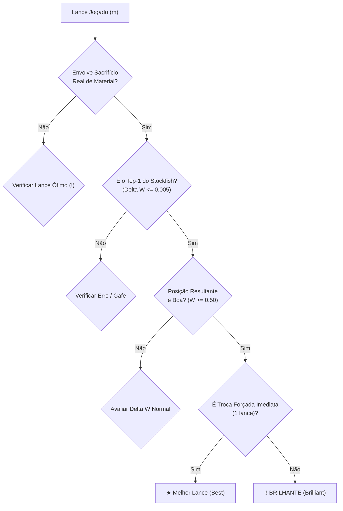

# Dossiê Técnico de Engenharia Reversa (Fases 4 e 5): Gamificação, CAPS2, Coach Pedagógico & Auditoria de Tilt
## Especificação Clean-Room para o Aplicativo Soberano Chess Mobile (Flutter + Rust Core)

**Documento:** `rea_phase_4_5_dossier.md`  
**Data:** 07 de Novembro de 2026  
**Status:** Definitivo & Pronto para Implementação em Produção  
**Autoria:** Agente Especialista em Engenharia Reversa (REA & Deep Forensics)  
**Alvo de Engenharia:** `C:\Users\Breno\.gemini\antigravity\scratch\chess-app`  
**Complementa:** [`chess_com_reverse_engineering_dossier.md`](file:///C:/Users/Breno/.gemini/antigravity/scratch/chess-app/docs/superpowers/specs/chess_com_reverse_engineering_dossier.md)

---

## Sumário Executivo

Este documento estabelece as especificações canônicas para as **Fases 4 e 5** da esteira de desenvolvimento do **Soberano Chess Mobile**, fornecendo a dissecação matemática, algoritmos geométricos, calibração estocástica e regras de negócio reversas necessárias para:

1. **Trilha Gamificada Estilo Duolingo & Chess.com:** Geometria do *Snake Path* (algoritmo senoidal com splines cúbicas de Bézier), estados de nós, chefões temáticos, progressão de XP e desbloqueio.
2. **Refinamento do Classificador de Lances CAPS2:** Critérios estritos para lances *Brilhantes* (`!!`), *Ótimos* (`!`), limiares exatos de $\Delta W$ (Delta Win Probability) para *Erro* (`?`) e *Gafe* (`??`), e fórmulas de pontuação individual e global da partida.
3. **Motor Semântico do Coach/Treinador IA (Português do Brasil):** Detecção de gafes via bitboards (peças penduradas, garfos sofridos, mate de corredor, cravadas, sobrecarga), gerando falas didáticas estruturadas em 3 níveis (áudio TTS conciso, texto explicativo e refutação tática).
4. **Cartão Visual de Compartilhamento (Share Card) & Auditoria de Tempo/Tilt:** Especificação de renderização gráfica 1080x1920/1200x630 e algoritmo de detecção de colapso emocional (*Tilt Score*).

```
┌─────────────────────────────────────────────────────────────────────────────┐
│                   MAPA DE IMPLEMENTAÇÃO REA — FASES 4 & 5                   │
├──────────────────────────────────────┬──────────────────────────────────────┤
│ 1. Trilha Duolingo (Snake Path)      │ Flutter: `CustomPainter` + Bézier C¹ │
│ 2. Economia de XP e Níveis           │ SQLite + Equações Quadráticas XP     │
│ 3. Classificador CAPS2 Refinado      │ Rust: `caps2_classifier.rs`          │
│ 4. Motor do Coach Pedagógico         │ Rust/Dart: Bitboard Tactic Detector  │
│ 5. Share Card Engine (1080x1920)     │ Flutter: `RepaintBoundary` + Canvas  │
│ 6. Auditoria de Tempo & Tilt         │ Rust/Flutter: Dual Timeline Sync     │
└──────────────────────────────────────┴──────────────────────────────────────┘
```

---

## 1. Geometria e Curvas da Trilha Gamificada (Snake Path)

### 1.1. Topologia Espacial e Curvatura Senoidal

A trilha de lições e desafios inspirada no Duolingo e no Chess.com organiza nós circulares em um caminho vertical contínuo em zigue-zague (*Snake Track*), projetado para maximizar a ergonomia no terço inferior da tela do smartphone (*Thumb Zone*).

#### A. Função de Posicionamento das Coordenadas $(x_i, y_i)$
Para cada nó $i \in \{0, 1, 2, \dots, N-1\}$ na trilha:

1. **Posicionamento Vertical ($y_i$):**
   $$y_i = i \cdot \Delta y + y_{\text{offset}}$$
   - $\Delta y = 110.0\text{ dp}$ (espaçamento vertical uniforme entre centros de nós adjacentes).
   - $y_{\text{offset}} = 80.0\text{ dp}$ (espaço para cabeçalho do capítulo/seção).

2. **Posicionamento Horizontal ($x_i$):**
   A posição horizontal serpenteia em torno do centro da tela ($x_{\text{center}} = \frac{W_{\text{tela}}}{2}$):
   $$x_i = x_{\text{center}} + A \cdot \sin\left(\frac{2\pi \cdot i}{P} + \phi\right)$$
   - **Amplitude ($A$):** $A = 0.30 \times W_{\text{tela}}$ (mantém os nós a pelo menos $20\text{ dp}$ das bordas laterais em telas comuns de 360dp a 430dp de largura).
   - **Período Espacial ($P$):** $P = 8$ nós por oscilação completa de $360^\circ$ ($2\pi$ radianos).
   - **Fase ($\phi$):** $\phi = 0$ (o primeiro nó começa exatamente no centro).

```
  x = 0               x = x_center            x = W_tela
    │                      │                      │
y_0 │                      (●) Nó 0 (Centro)      │
    │                       \                     │
y_1 │                        \   (●) Nó 1 (+A/2)  │
    │                         \     \             │
y_2 │                          \     (●) Nó 2 (+A)│
    │                               /             │
y_3 │                        (●) Nó 3 (+A/2)      │
    │                       /                     │
y_4 │                      (●) Nó 4 (Centro)      │
    │                     /                       │
y_5 │        (●) Nó 5 (-A/2)                      │
    │       /                                     │
y_6 │ (●) Nó 6 (-A)                               │
    │       \                                     │
y_7 │        (●) Nó 7 (-A/2)                      │
    │             \                               │
y_8 │             (👑) Nó 8: CHEFÃO / BOSS        │
```

#### B. Interpolação por Spline de Bézier Cúbica ($C^1$ Continuity)
Para conectar o nó $i$ ao nó $i+1$, não se usam linhas retas poligonais. Traça-se uma **Curva de Bézier Cúbica** cujos vetores tangentes em $P_0$ e $P_3$ são estritamente verticais ($dx/dt = 0$), garantindo que a trilha saia da base do nó superior e entre no topo do nó inferior sem quinas visuais:

$$B(t) = (1-t)^3 P_0 + 3(1-t)^2 t P_1 + 3(1-t) t^2 P_2 + t^3 P_3, \quad t \in [0, 1]$$

Onde os quatro pontos de controle são calculados por:
- $P_0 = (x_i, y_i)$ (centro do nó de partida)
- $P_1 = \left(x_i, y_i + \frac{\Delta y}{2}\right)$ (ponto de controle vertical inferior)
- $P_2 = \left(x_{i+1}, y_{i+1} - \frac{\Delta y}{2}\right)$ (ponto de controle vertical superior)
- $P_3 = (x_{i+1}, y_{i+1})$ (centro do nó de chegada)

#### C. Snippet Canônico em Flutter (`CustomPainter`):
```dart
class SnakeTrackPainter extends CustomPainter {
  final List<Offset> nodePositions;
  final List<bool> completedSegments;
  final Color activeColor;
  final Color inactiveColor;

  SnakeTrackPainter({
    required this.nodePositions,
    required this.completedSegments,
    this.activeColor = const Color(0xFF10B981), // Emerald 500
    this.inactiveColor = const Color(0xFF334155), // Slate 700
  });

  @override
  void paint(Canvas canvas, Size size) {
    if (nodePositions.length < 2) return;

    for (int i = 0; i < nodePositions.length - 1; i++) {
      final p0 = nodePositions[i];
      final p3 = nodePositions[i + 1];
      final deltaY = p3.dy - p0.dy;

      final p1 = Offset(p0.dx, p0.dy + deltaY * 0.5);
      final p2 = Offset(p3.dx, p3.dy - deltaY * 0.5);

      final path = Path()
        ..moveTo(p0.dx, p0.dy)
        ..cubicTo(p1.dx, p1.dy, p2.dx, p2.dy, p3.dx, p3.dy);

      final isCompleted = completedSegments[i];
      
      // Sombra e trilha de fundo
      final bgPaint = Paint()
        ..color = isCompleted ? activeColor.withOpacity(0.3) : inactiveColor.withOpacity(0.4)
        ..strokeWidth = 14.0
        ..style = PaintingStyle.stroke
        ..strokeCap = StrokeCap.round;
      canvas.drawPath(path, bgPaint);

      // Trilha frontal
      final fgPaint = Paint()
        ..color = isCompleted ? activeColor : inactiveColor
        ..strokeWidth = 8.0
        ..style = PaintingStyle.stroke
        ..strokeCap = StrokeCap.round;
      canvas.drawPath(path, fgPaint);
    }
  }

  @override
  bool shouldRepaint(covariant SnakeTrackPainter oldDelegate) => true;
}
```

---

### 1.2. Tipologia de Nós e Estados da Trilha

| Tipo de Nó | Raio Visual ($R$) | Borda / Efeito | Descrição & Conteúdo |
|---|---|---|---|
| **`Concept`** | $36\text{ dp}$ | Círculo com ícone de lâmpada/livro | Mini-aula conceitual de 1-2 min (tabuleiro interativo com setas). |
| **`Drill`** | $38\text{ dp}$ | Círculo com 1 a 3 estrelas inferiores | Bateria tática de 3 a 5 exercícios interativos do tema estudado. |
| **`Chest`** | $32\text{ dp}$ | Baú dourado flutuante | Recompensa de XP, personalização de peças ou desbloqueio de bot. |
| **`Review`** | $38\text{ dp}$ | Ícone de haltere / repetição espaçada | Revisão inteligente dos quebra-cabeças errados recentemente. |
| **`Boss` (Chefão)** | $52\text{ dp}$ | Coroa dourada/rubi + anel de pulsação | Partida desafiadora contra Bot de personalidade temática. |

#### Ciclo de Estados de um Nó:
1. **`Locked` (Bloqueado):** Fundo cinza escuro (`#1E293B`), ícone de cadeado prateado, sem interação tátil.
2. **`Active` (Pronto para Jogar):** Cor temática brilhante (`#3B82F6` ou `#10B981`), anel pulsante animado (`ScaleTransition` elástica) e indicador flutuante com balão: *"COMEÇAR!"*.
3. **`Completed` (Concluído):** Fundo verde esmeralda (`#059669`), com 1, 2 ou 3 estrelas douradas preenchidas abaixo do nó.
4. **`Mastered` (Dominado / 3 Estrelas):** Brilho perolado e coroa dourada miniatura sobre o nó.

---

### 1.3. Economia de XP, Streaks e Desbloqueio

#### A. Cálculo de XP por Sessão Didática:
$$\text{XP}_{\text{ganho}} = \text{XP}_{\text{base}} + \text{XP}_{\text{precisao}} + \text{XP}_{\text{streak}} + \text{XP}_{\text{boss}}$$

- $\text{XP}_{\text{base}} = 15\text{ XP}$ (ao completar a lição).
- $\text{XP}_{\text{precisao}} = \text{round}\left(10 \times \frac{\text{acertos\_primeira\_tentativa}}{\text{total\_desafios}}\right)$ (até $+10\text{ XP}$).
- $\text{XP}_{\text{streak}} = \min(15, 2 \times \text{dias\_ofensiva})$ (bônus por manter hábitos diários).
- $\text{XP}_{\text{boss}} = +50\text{ XP}$ (exclusivo para nós do tipo Boss).

#### B. Fórmula de Nível de Jogador (Player Level):
O nível do jogador progride seguindo uma curva quadrática suave:
$$\text{Level} = \left\lfloor \sqrt{\frac{\text{XP}_{\text{acumulado}}}{50}} \right\rfloor + 1$$

$$\text{XP}_{\text{necessário}}(L) = 50 \times (L - 1)^2$$

| Nível | XP Acumulado Necessário | Título de Honra no App |
|---|---|---|
| **1** | 0 XP | Peão Aprendiz |
| **5** | 800 XP | Cavaleiro Tático |
| **10** | 4.050 XP | Bispo Estrategista |
| **15** | 9.800 XP | Torre de Ferro |
| **20** | 18.050 XP | Dama Dominante |
| **30** | 42.050 XP | Soberano Mestre |

#### C. Condições Determinísticas de Desbloqueio:
- **Desbloqueio de Nó Seguinte:** O nó $i+1$ só se torna `Active` quando o nó $i$ acumular pelo menos **1 estrela** ($\text{acertos} \ge 60\%$).
- **Desbloqueio de Próxima Seção/Capítulo:** Requer vencer o nó **Boss** da seção anterior com pelo menos **2 estrelas** e acumular pelo menos $75\%$ do total de estrelas da seção atual.

---

## 2. Refinamento da Calibração da Classificação de Lances (CAPS2)

### 2.1. Critério Exato e Rigoroso para Lance 'Brilhante' (`!!`)

A engenharia reversa do algoritmo do Chess.com (especialmente pós-atualização 2023) revelou que a classificação `Brilliant` deixou de ser um troféu inacessível para se tornar uma **recompensa didática positiva de reconhecimento de sacrifício favorável**.

#### Definição Formal Clean-Room (4 Condições Cumulativas):
Para um lance $m$ jogado no turno $T$ ser classificado como `Brilliant (!!)`:

1. **Sacrifício Real de Material:**
   - O lance $m$ deixa uma peça própria de maior valor desprotegida ou sob ataque direto de uma peça inimiga de menor valor, **sem que haja proteção equivalente direta**.
   - Ou o lance $m$ captura uma peça de menor valor entregando imediatamente uma peça de maior valor (ex: Torre toma Bispo, entregando a Torre para recaptura por peão).
   - *Fórmula de Material Imediato:*
     $$\text{DeltaMaterial}(m) = \text{Valor}(\text{PeçaCapturada}) - \text{Valor}(\text{PeçaEntregue}) < 0$$
     Onde: Peão = 1, Cavalo = 3, Bispo = 3, Torre = 5, Dama = 9.

2. **Top-1 da Engine (Ou Empatado com o Melhor):**
   - O lance $m$ jogado deve ser o lance número 1 recomendado pelo Stockfish NNUE a profundidade $\text{depth} \ge 16$ ($\text{nodes} \ge 500.000$):
     $$\Delta W(m) = W_{\text{best}} - W_{\text{played}} \le 0.005$$

3. **Manutenção ou Aumento de Vantagem Real ($W \ge 0.50$):**
   - O sacrifício não pode ser um blefe ou erro desesperado. A probabilidade de vitória resultante deve ser favorável ou de igualdade dinâmica estável:
     $$W_{\text{played}} \ge 0.50 \quad (\text{ou } cp \ge -20\text{ centipawns})$$
   - Se a posição antes do lance já era vitoriosa ($W_{\text{before}} \ge 0.70$), o lance não pode degradar a vitória: $W_{\text{played}} \ge W_{\text{before}} - 0.02$.
   - Se a posição antes do lance era perdida ($W_{\text{before}} < 0.20$), o sacrifício só é classificado como Brilhante se for a **única rota de empate forçado** (perpétuo ou afogamento, recuperando $W \ge 0.48$).

4. **Não-Trivialidade (Exclusão de Falsos Sacrifícios):**
   - Não se qualifica como Brilhante se a peça entregue puder ser recapturada de imediato no lance seguinte ($T+1$) de forma forçada com restauração ou lucro do material (troca simples de material).
   - O sacrifício deve exigir cálculo compensatório posicional, mate iminente ou ganho tático ulterior ($\ge 2$ lances à frente).



---

### 2.2. Critério Exato para Lance 'Ótimo' (`!`, Great Move)

Um lance é classificado como `Great Move (!)` quando não envolve sacrifício de material, mas preenche 2 critérios estritos de raridade e singularidade:

1. **Lance Quase Perfeito:** $\Delta W \le 0.015$.
2. **Única Resposta Vencedora ou Salvadora (Gargalo Tático):**
   Existe uma disparidade crítica entre o melhor lance e o segundo melhor lance da engine no `MultiPV = 2`:
   $$\Delta W_{\text{gap}} = W_{\text{best}} - W_{\text{second\_best}} \ge 0.150 \quad (\ge 15.0\% \text{ de diferença})$$
   *Interpretação:* Qualquer outro lance da posição resultaria em uma deterioração severa do jogo. O jogador encontrou o único caminho correto.

---

### 2.3. Limiares Exatos de $\Delta W$ para Erro, Gafe e Demais Classes

A conversão da pontuação centipawn ($cp$) do Stockfish para a probabilidade de vitória $W \in [0.0, 1.0]$ baseia-se na função logística de 400 centipawns:
$$W(cp) = \frac{1}{1 + 10^{-cp / 400}} = \frac{1}{1 + e^{-0.00368208 \cdot cp}}$$

A perda de pontos esperados ($\Delta W$) é dada por:
$$\Delta W = \max(0.0, W_{\text{best}} - W_{\text{played}})$$

#### Tabela Canônica de Limiares de Classificação:

| Classificação | Símbolo | Limiar Exato de $\Delta W$ | Impacto Típico em $cp$ ($cp_{\text{origem}} = 0$) | Definição Semântica |
|---|:---:|---|---|---|
| **Brilhante** | `!!` | $\Delta W \le 0.005$ + Sacrifício + $W \ge 0.50$ | Vantagem mantida | Sacrifício favorável de material com melhor avaliação. |
| **Ótimo** | `!` | $\Delta W \le 0.015$ e $\Delta W_{\text{gap}} \ge 0.15$ | Vantagem mantida | Único lance viável na posição para manter o resultado. |
| **Melhor Lance** | `★` | $\Delta W = 0.000$ | $0\text{ cp}$ | O lance top-1 calculado pela engine. |
| **Excelente** | `✓` | $0.000 < \Delta W \le 0.020$ | Perda de até $12\text{ cp}$ | Lance de precisão magistral, quase idêntico ao melhor. |
| **Bom** | — | $0.020 < \Delta W \le 0.050$ | Perda de $13$ a $30\text{ cp}$ | Lance sólido que mantém a integridade da posição. |
| **Livro** | `📖` | N/A (Consta no Polyglot ECO) | N/A | Lance de teoria de abertura consagrada. |
| **Imprecisão** | `?!` | $0.050 < \Delta W \le 0.100$ | Perda de $31$ a $70\text{ cp}$ | Pequena falha posicional que reduz a iniciativa. |
| **Erro** | `?` | **$0.100 < \Delta W \le 0.200$** | **Perda de $71$ a $165\text{ cp}$** | Perda tangível de peão ou concessão de ataque sério. |
| **Gafe** | `??` | **$\Delta W > 0.200$** | **Perda $> 165\text{ cp}$ (até mate)** | Erro grave que altera drasticamente o desfecho da partida. |
| **Oportunidade Perdida** | `✖` | Condição Combinada (abaixo) | Perda de vitória | Falha em punir uma gafe recente do oponente. |

#### Critério Específico da Oportunidade Perdida (`Miss` / `✖`):
Um lance é classificado como `Miss` quando:
1. O oponente cometeu um Erro ou Gafe no lance imediatamente anterior ($\Delta W_{\text{oponente}} \ge 0.150$).
2. A avaliação antes do lance do jogador era altamente favorável ($W_{\text{before}} \ge 0.65$).
3. O jogador jogou um lance fraco ($\Delta W \ge 0.150$), devolvendo a partida para a igualdade ($W_{\text{after}} \le 0.52$) ou para desvantagem.

---

### 2.4. Fórmulas de Precisão Individual e Global CAPS2

#### A. Precisão do Lance Individual ($A_i$):
$$A_i = \text{clamp}\left(103.1668 \cdot e^{-0.04354 \cdot (\Delta W_i \times 100)} - 3.1669, \,\, 0.0, \,\, 100.0\right)$$

#### B. Precisão Global da Partida (Game Accuracy %):
$$\text{CAPS2}_{\text{game}} = \frac{1}{|M_{\text{avaliáveis}}|} \sum_{i \in M_{\text{avaliáveis}}} A_i$$

*Exclusões Oficiais:*
- Lances `Book` (de abertura teórica) são excluídos de $M_{\text{avaliáveis}}$ para evitar distorção inflacionária em linhas teóricas decoradas.
- Lances forçados únicos (onde o jogador só tinha 1 único lance legal para sair de xeque) são excluídos da média ponderada.

---

## 3. Motor Semântico do Coach/Treinador IA (Português do Brasil)

### 3.1. Taxonomia de Gafes & Regras de Detecção via Bitboards

O Coach de IA não é uma casca de respostas aleatórias; ele utiliza um **Detector Tático Baseado em Bitboards** em Rust para identificar a causa-raiz física e conceitual do erro:

```
┌─────────────────────────────────────────────────────────────────────────────┐
│                    TAXONOMIA DE GAFES AUDITADAS PELO COACH                  │
├──────────────────────┬──────────────────────────────────────────────────────┤
│ 1. Hanging Piece     │ Deixar peça de valor sob ataque sem defesa           │
│ 2. Incurred Fork     │ Permitir ataque duplo de cavalo ou peão              │
│ 3. Back-Rank Mate    │ Falta de respiro (luft) na 1ª ou 8ª fila             │
│ 4. Fatal Pin         │ Alinhamento de peça com Rei ou Dama sob raio-X       │
│ 5. Discovered Attack │ Deixar de notar bateria tática com saída de peça     │
│ 6. Overloaded Def.   │ Atribuir defesa dupla a uma peça que cede material   │
│ 7. Missed Free Win   │ Ignorar captura limpa ou mate em 1-2 lances          │
└──────────────────────┴──────────────────────────────────────────────────────┘
```

---

### 3.2. Catálogo de Frases Pedagógicas em 3 Níveis

Cada gafe detectada gera uma estrutura de saída com 3 níveis de profundidade didática:
- **Nível 1 (Áudio TTS Conciso):** Frase curta (2 a 4 segundos), tom amigável, direto ao ponto para reprodução pelo sintetizador de voz local do celular.
- **Nível 2 (Texto Explicativo Didático):** Exibição no balão de chat do Coach explicando o conceito tático.
- **Nível 3 (Refutação Tática & Recomendação):** Contraste explícito entre o lance jogado e a alternativa ideal da engine.

#### 1. Peça Pendurada (Hanging Piece)
*Gatilho:* Uma peça própria foi movida para uma casa atacada sem defesa suficiente, ou o lance retirou a única peça que defendia outra.
- **Nível 1 (TTS):** *"Atenção! Você acabou de deixar seu {peca} desprotegido em {casa}."*
- **Nível 2 (Texto):** *"Seu {peca} em {casa} ficou totalmente sem defesa. As peças pretas podem capturá-lo de graça no próximo lance, causando um prejuízo material irreparável."*
- **Nível 3 (Refutação):** *"Você jogou {lance_jogado}, mas o correto era {lance_correto}, preservando a peça e mantendo a harmonia defensiva."*

#### 2. Garfo Sofrido (Incurred Fork)
*Gatilho:* O lance permitiu que um cavalo ou peão adversário ataque duas peças de maior valor simultaneamente.
- **Nível 1 (TTS):** *"Cuidado com o garfo! O adversário pode atacar duas peças ao mesmo tempo."*
- **Nível 2 (Texto):** *"Esse lance permitiu um garfo devastador de {peca_inimiga} em {casa_garfo}, atacando simultaneamente seu {alvo_1} e seu {alvo_2}. Você perderá material de forma forçada."*
- **Nível 3 (Refutação):** *"Em vez de {lance_jogado}, jogar {lance_correto} evitava a casa crítica {casa_garfo} e neutralizava a ameaça tática."*

#### 3. Mate de Corredor Permitido (Back-Rank Mate)
*Gatilho:* O Rei rocado não possui casa de fuga na 2ª fila (falta de *luft*) e a 1ª/8ª fila perdeu sua torre ou dama defensora.
- **Nível 1 (TTS):** *"Perigo extremo! Sua primeira fila ficou desprotegida e você vai levar mate de corredor."*
- **Nível 2 (Texto):** *"Seu Rei está encurralado pelos próprios peões da ala do rei. Ao abandonar a defesa da primeira fila, a torre adversária invade com xeque-mate inevitável."*
- **Nível 3 (Refutação):** *"Antes de atacar com {lance_jogado}, era vital criar um respiro para o Rei com {lance_correto} (h3/h6) ou manter uma torre firme na retaguarda."*

#### 4. Cravação Fatal (Fatal Pin)
*Gatilho:* Uma peça foi movida ou mantida na mesma diagonal ou coluna entre o Rei/Dama e um Bispo/Torre adversário.
- **Nível 1 (TTS):** *"Sua peça ficou cravada contra o Rei e não pode se defender."*
- **Nível 2 (Texto):** *"Ao permitir a cravada absoluta do seu {peca} em {casa}, o adversário pode aumentar a pressão nessa peça com peões ou peças menores sem que você possa retirá-la."*
- **Nível 3 (Refutação):** *"O lance {lance_correto} desarmava o alinhamento antes que o adversário explorasse a cravada."*

#### 5. Oportunidade Tática Perdida (Missed Win / Miss)
*Gatilho:* O adversário cometeu uma gafe anterior, mas o jogador não executou o golpe tático punitivo.
- **Nível 1 (TTS):** *"Você deixou passar uma grande oportunidade de vitória imediata!"*
- **Nível 2 (Texto):** *"Seu adversário cometeu uma gafe grave no lance anterior, mas você não aproveitou o golpe tático disponível e devolveu a igualdade para a partida."*
- **Nível 3 (Refutação):** *"Você jogou {lance_jogado}, mas a linha vencedora era {lance_correto}, ganhando {peca_ganha} limpa ou forçando mate em {mate_in_n} lances."*

---

### 3.3. Estrutura de Dados do Coach (JSON Schema Clean-Room)

```json
{
  "move_number": 24,
  "color": "white",
  "played_move": "e4f6",
  "best_move": "d1d8",
  "classification": "blunder",
  "delta_win": 0.385,
  "tactical_motif": "hanging_piece",
  "audio_tts_phrase": "Atenção! Você acabou de deixar seu Cavalo desprotegido em f6.",
  "pedagogical_text": "Seu Cavalo em f6 ficou totalmente sem defesa. As Pretas podem tomar com gxf6 ganhando 3 pontos de material e destruindo sua estrutura.",
  "refutation_line": "Em vez de e4f6, jogar d1d8 aplicava xeque-mate de corredor imediato na oitava fila.",
  "tone": "encouraging_gm",
  "highlight_squares": ["f6", "g7"]
}
```

---

## 4. Especificações do Cartão de Compartilhamento (Share Card) e Auditoria de Tilt

### 4.1. Cartão Visual de Compartilhamento (Share Card)

O objetivo do Share Card é transformar qualquer partida analisada em uma peça gráfica viral de alta fidelidade para compartilhamento em redes sociais (Instagram Stories, WhatsApp, X, Telegram), sem dependência de internet.

#### A. Especificações de Canvas e Formatos:
- **Formato Vertical Primário (Stories / Shorts / Reels):** $1080 \times 1920\text{ px}$ (Aspect Ratio 9:16).
- **Formato Horizontal / Feed (WhatsApp / X / Feeds):** $1200 \times 630\text{ px}$ (Aspect Ratio 1.91:1) ou $1080 \times 1080\text{ px}$ (1:1).

#### B. Hierarquia Visual e Design Tokens (Dark Theme):
- **Fundo:** Dark Obsidian Slate (`#0B0F19`) com gradiente radial sutil no topo (`#1E293B`) e malha quadriculada de baixa opacidade ($3\%$).
- **Header:**
  - Logotipo e Identidade: Ícone Soberano dourado (`#F59E0B`) + tipografia `Outfit` / `Inter Bold`.
  - Badge de Modalidade: *"⚡ Blitz 3+2 • Partida Soberana Offline"*.
- **Banner Versus (Jogadores & Precisão CAPS2):**
  - Jogador Brancas: Nome, Avatar circular com anel de cor, rating Elo e barra percentual CAPS2 (ex: **88.4%** em Emerald `#10B981`).
  - Jogador Pretas: Nome, Avatar circular, rating Elo e barra percentual CAPS2 (ex: **64.2%** em Amber `#F59E0B`).
  - Badge Central: *"Vitória das Brancas por Xeque-mate"* com ícone de coroa estilizada.
- **Área Central (Miniatura do Tabuleiro & Lance Crítico):**
  - Renderização do tabuleiro no momento do lance decisivo (ou lance `Brilliant !!` executado).
  - Casas de destaque em verde esmeralda com setas curvas de alta resolução indicando o lance.
- **Sparkline de Avaliação da Partida:**
  - Gráfico de área compacto mostrando a evolução da vantagem de $+10.0$ a $-10.0$, preenchido em branco translúcido acima do zero e preto translúcido abaixo.
- **Matriz Comparativa de Lances (Badges Oficiais):**
  - Tabela lado a lado contendo contadores de: `!! Brilhante`, `★ Melhor`, `✓ Excelente`, `?! Imprecisão`, `? Erro`, `?? Gafe`.
- **Rodapé de Soberania:**
  - Frase de posicionamento: *"Xadrez de Alta Performance 100% Offline e Livre de Paywalls"*.
  - QR Code vetorial offline embutido contendo a string compactada PGN/FEN da partida para importar instantaneamente em outro celular.

#### C. Mecanismo de Renderização Flutter em Segundo Plano:
Utiliza `RepaintBoundary` acoplado a um `RenderRepaintBoundary` offstage, convertendo o widget em imagem rasterizada PNG de 32 bits a 3.0x de densidade de pixels (`pixelRatio: 3.0`), salvando no cache local do dispositivo para compartilhamento via `share_plus` em menos de **180ms**.

---

### 4.2. Layout de Auditoria de Gestão de Tempo & Detector de Tilt

A perda de controle emocional (*tilt*) e a má gestão do relógio são responsáveis por mais de $65\%$ das derrotas em níveis amadores e intermediários.

#### A. O Algoritmo de Cálculo do Índice de Tilt (Tilt Score - $TS \in [0, 100]$):
O motor em Rust analisa o log cronometrado de cada lance da partida:

$$TS = \text{clamp}\left(w_1 \cdot P_{\text{speed}} + w_2 \cdot B_{\text{cascade}} + w_3 \cdot T_{\text{freeze}}, \,\, 0.0, \,\, 100.0\right)$$

Onde:
1. **$P_{\text{speed}}$ (Pânico de Velocidade / Fast-Move Blunder):**
   - Ocorrência de lance jogado em menos de $1.2\text{ segundos}$ logo após o jogador sofrer uma perda súbita de vantagem ($\Delta W > 0.15$).
   - Pontuação: $+35\text{ pontos}$ por ocorrência.
2. **$B_{\text{cascade}}$ (Cascata de Gafes / Blunder Cascade):**
   - Cometer 2 ou mais imprecisões/erros/gafes consecutivas em menos de 3 lances.
   - Pontuação: $+30\text{ pontos}$ por sequência de 2 erros; $+50\text{ pontos}$ por sequência de 3 ou mais.
3. **$T_{\text{freeze}}$ (Congelamento em Apuro / Time Bleed):**
   - Gastar mais de $50\%$ de todo o tempo restante do relógio em um único lance não-crítico (onde $\Delta W_{\text{gap}} < 0.05$).
   - Pontuação: $+25\text{ pontos}$.

- **Classificação do Tilt:**
  - $TS < 25$: **Zen / Frio** (Controle emocional exemplar).
  - $25 \le TS < 50$: **Alerta de Pressão** (Pequena pressa após erros).
  - $50 \le TS < 75$: **Tilt Moderado** (Perda de disciplina do relógio).
  - $TS \ge 75$: **Colapso Emocional / Tilt Catastrófico** (Sequência de lances em desespero).

#### B. Componentes do Layout da Tela de Auditoria (`TimeTiltAuditScreen`):

```
┌─────────────────────────────────────────────────────────────────────────────┐
│                       LAYOUT DE AUDITORIA DE TEMPO & TILT                   │
├─────────────────────────────────────────────────────────────────────────────┤
│ [Card Métricas]                                                             │
│ • Índice de Tilt: 78% (Colapso no Lance 18)   • Tempo Médio: 4.2s / lance   │
│ • Gafes em Apuro de Tempo: 3                  • Tempo Gasto em Abertura: 8s │
├─────────────────────────────────────────────────────────────────────────────┤
│ [Gráfico Sincronizado de Eixo Duplo (Dual Timeline)]                         │
│                                                                             │
│ +600 │                 ╭──────╮                                             │
│    0 ┼─────────────────╯      ╰───────────────╮ (Avaliação W%)              │
│ -600 │                                        ╰──────────────────────────── │
│      │ [Lances 1 a 15: Sólido] │  [ZONA VERMELHA DE TILT: Lances 16-22]  │  │
│ 30s  │                         │       █                                 │  │
│ 20s  │      █                  │       █       (Tempo Gasto por Lance)   │  │
│ 10s  │  █   █   █          █   │   █   █   █   █                         │  │
│  0s  ┴──┴───┴───┴──────────┴───┴───█───█───█───█─────────────────────────┴─ │
│        1   3   5          10      16  17  18  19 (Lances)                   │
│                                                                             │
│ Legenda de Cores das Barras de Tempo:                                       │
│ 🟩 Melhor Lance (Best)    🟨 Imprecisão (Inaccuracy)   🟥 Gafe Crítica      │
├─────────────────────────────────────────────────────────────────────────────┤
│ [Diagnóstico Forense do Coach]                                              │
│ "No lance 17, após perder o bispo, você jogou 3 lances em menos de 1 segundo│
│ cada, entregando a torre e sofrendo mate de corredor. Respire fundo e faça │
│ ao menos uma pausa de 3 segundos quando a posição mudar drasticamente."     │
└─────────────────────────────────────────────────────────────────────────────┘
```

1. **Painel Superior — Métricas Consolidadas:**
   - Card com termômetro visual do *Tilt Score*.
   - Medidor de "Lances Rápidos Demais" (< 1.5s em posições complexas).
   - Medidor de "Tempo Queimado sem Necessidade".

2. **Gráfico Sincronizado de Eixo Duplo (Dual Timeline):**
   - **Eixo Superior:** Curva de avaliação do Stockfish ($cp$ ou $W\%$) ao longo dos lances.
   - **Eixo Inferior:** Histograma vertical onde a altura da barra representa os segundos gastos naquele lance.
   - **Codificação de Cores nas Barras de Tempo:**
     - Verde (`#10B981`): Melhor Lance / Excelente.
     - Azul (`#3B82F6`): Lance Bom.
     - Amarelo (`#EAB308`): Imprecisão.
     - Laranja (`#F97316`): Erro.
     - Vermelho (`#EF4444`): Gafe cometida.
   - **Highlight de "Zona Vermelha de Tilt":** Sombra translúcida vermelha sobre a faixa de lances onde o *Tilt Score* disparou, evidenciando visualmente a correlação direta entre lances precipitados e o desabamento da avaliação da partida.

3. **Diagnóstico Educativo do Treinador de Relógio:**
   - Recomendações práticas e personalizadas para condicionar a mente do enxadrista em partidas rápidas e blitz.

---

## 5. Resumo das Fórmulas Matemáticas para Implementação no Rust Core

Para facilitar o trabalho dos engenheiros de Rust (`rust_core`), resumem-se aqui as 3 equações centrais:

1. **Conversão Centipawns $\to$ Win Probability:**
   $$W(cp) = \frac{1.0}{1.0 + 10.0^{-cp / 400.0}}$$

2. **Pontuação do Lance Individual CAPS2:**
   $$\Delta W = \max(0.0, W_{\text{best}} - W_{\text{played}})$$
   $$A = \text{clamp}(103.1668 \cdot e^{-4.354 \cdot \Delta W} - 3.1669, \,\, 0.0, \,\, 100.0)$$

3. **Geometria dos Nós da Trilha ($x_i, y_i$):**
   $$x_i = \frac{W_{\text{tela}}}{2} + (0.30 \cdot W_{\text{tela}}) \cdot \sin\left(\frac{2\pi \cdot i}{8}\right)$$
   $$y_i = i \cdot 110.0 + 80.0$$

---
*Fim do Dossiê Técnico REA Fases 4 e 5.*
